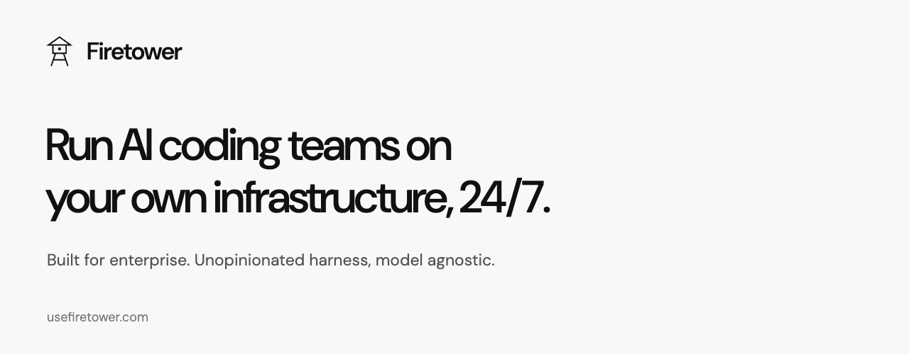
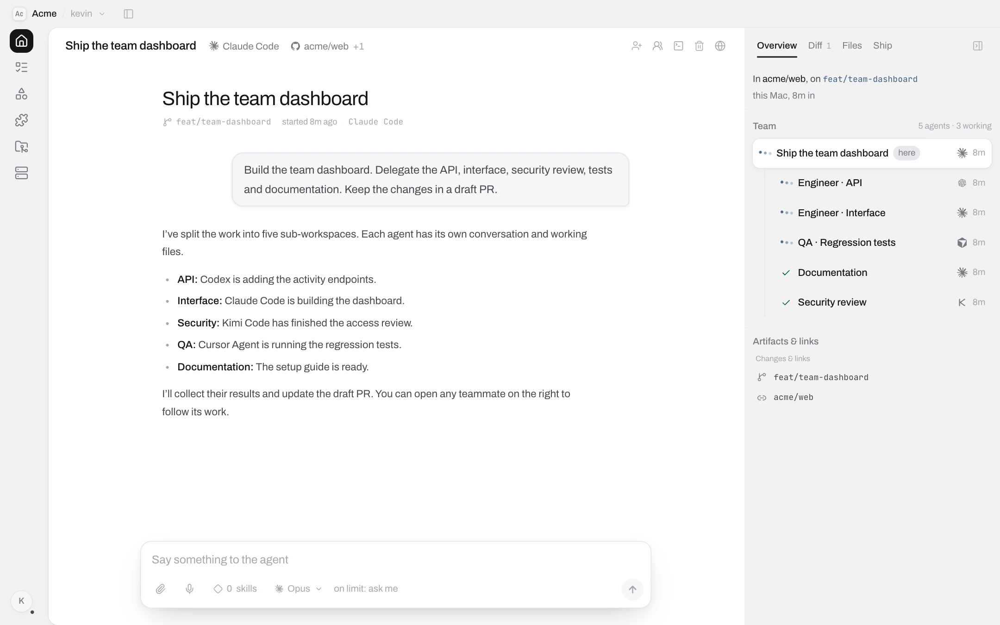
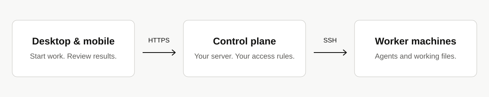

<picture>
  <source media="(prefers-color-scheme: dark)" srcset=".github/assets/header-dark.png">
  
</picture>

[Download](https://usefiretower.com/docs/join) · [Self-host](https://usefiretower.com/docs/install-firetower) · [Documentation](https://usefiretower.com/docs) · [Discord](https://discord.gg/Y2HYVEhSc)

Firetower is an open-source workspace for running teams of AI agents on infrastructure you control. Choose your agents, machines, instructions and skills. Follow their conversations and review the results in one place.

<picture>
  <source media="(prefers-color-scheme: dark)" srcset=".github/assets/agent-team-dark.webp">
  
</picture>

*A lead agent coordinating API work, interface changes, security review, QA and documentation. Actual desktop interface with sample data.*

## What you can do

- **Run agent teams.** Give specialists their own profiles, skills and working files. Open a sub-workspace to follow its conversation.
- **Keep work running.** Agents execute on worker machines. Close your laptop and return from another client.
- **Bring your subscriptions.** Connect supported agent subscriptions or API credentials. Configure account fallback when usage limits are reached.
- **Share across your company.** Share skills, profiles, subscriptions, workspaces and artifacts. Control access through people, teams and directories.
- **Review the output.** Inspect diffs, open pull requests, and annotate artifacts and application previews.
- **Work beyond code.** Use one or more repositories, or none. Ask for documentation, analysis, operational reports or other file-based work.

## Get started

### Join an existing installation

[Download Firetower](https://usefiretower.com/docs/join), enter your company’s Firetower address, and sign in. Desktop clients are available for macOS and Windows; mobile clients for iOS and Android.

### Host your own

Prepare a Linux server and follow the [installation guide](https://usefiretower.com/docs/install-firetower). Run:

```sh
curl -fsSL https://usefiretower.com/install.sh | sh
```

Then [add a worker machine](https://usefiretower.com/docs/machines), [connect an agent account](https://usefiretower.com/docs/accounts), and [start your first workspace](https://usefiretower.com/docs/first-run). Keep workers separate from the control-plane server.

## How it works



The control plane coordinates work and manages access. Workers run agents and keep their working files. Desktop and mobile apps connect as clients.

A private network such as Tailscale can keep the control plane private. Closing a client does not stop an agent on a running worker. See [architecture](https://usefiretower.com/docs/architecture) for the role of each layer.

## Supported tools

**Agents:** Claude Code, Codex, Kimi Code and Cursor Agent.

**Git hosts:** GitHub, GitHub Enterprise Server, GitLab, GitLab self-managed, Gitea and Forgejo.

Connect multiple accounts and git hosts, including several instances of the same provider. For tasks and issues, see [connect your task tracker](https://usefiretower.com/docs/trackers).

## Documentation

| Start here | Work with agents | Manage your team |
| --- | --- | --- |
| [Requirements](https://usefiretower.com/docs/requirements) | [Agent profiles](https://usefiretower.com/docs/profiles) | [People and teams](https://usefiretower.com/docs/people) |
| [Install Firetower](https://usefiretower.com/docs/install-firetower) | [Skills](https://usefiretower.com/docs/skills) | [Share resources](https://usefiretower.com/docs/sharing) |
| [Key concepts](https://usefiretower.com/docs/concepts) | [Runs and sub-workspaces](https://usefiretower.com/docs/runs) | [Subscription fallback](https://usefiretower.com/docs/fallback) |

For agents: [llms.txt](https://usefiretower.com/llms.txt) and [complete Markdown documentation](https://usefiretower.com/llms-full.txt).

## Contributing and support

Firetower is under active development. Expect changes and occasional bugs. [Open an issue](https://github.com/firetower-cloud/firetower/issues) for a reproducible problem, or [join Discord](https://discord.gg/Y2HYVEhSc) to discuss an idea.

Read [CONTRIBUTING.md](CONTRIBUTING.md) before starting a contribution. If Firetower is useful to you, a star helps others find it.

## License

[AGPL-3.0-only](LICENSE). Copyright © Westlabs LLC.
